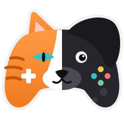
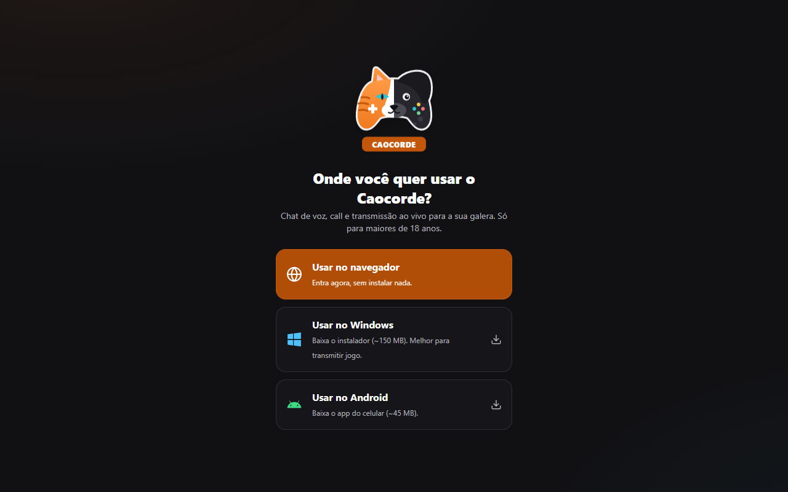
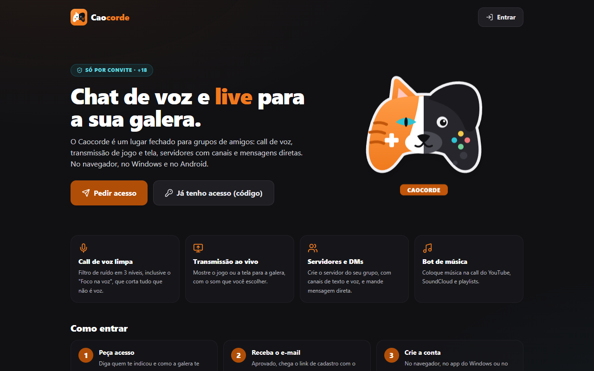
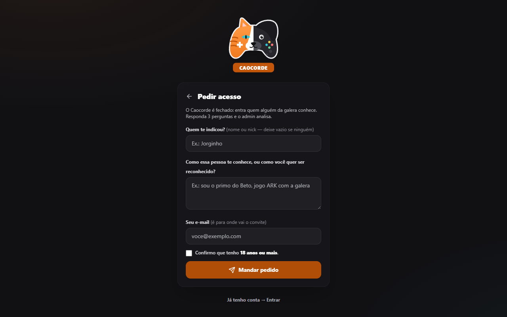
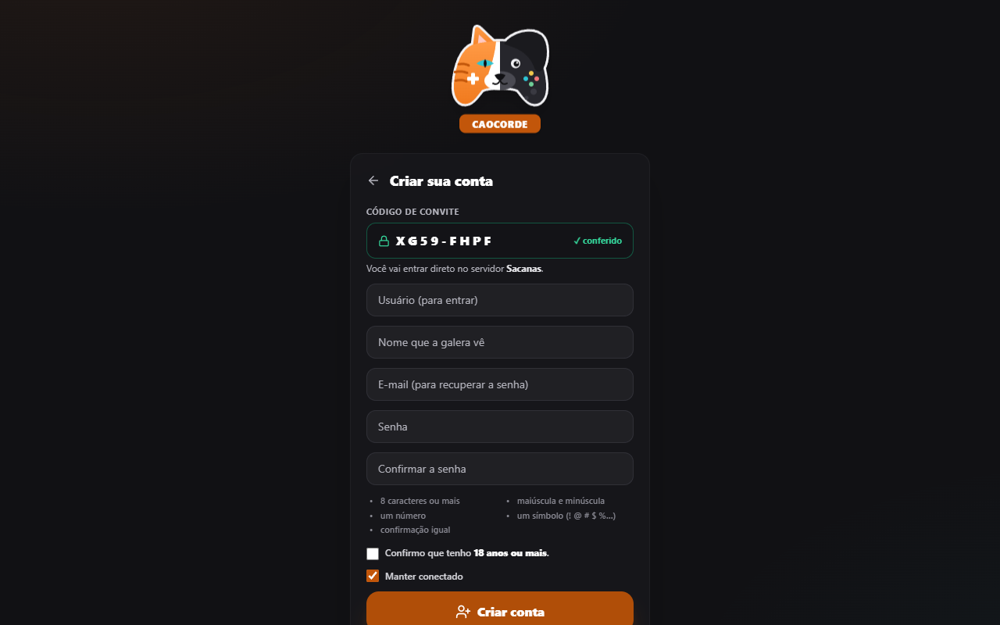
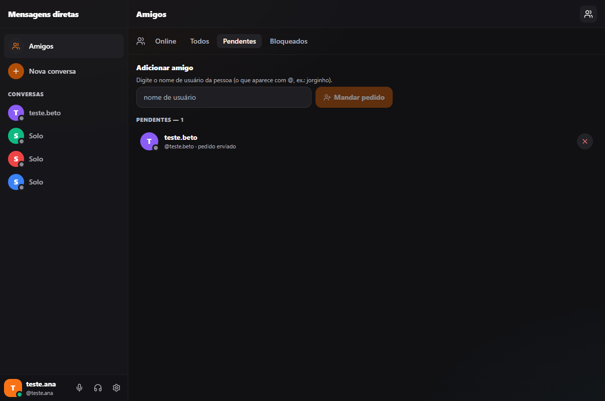
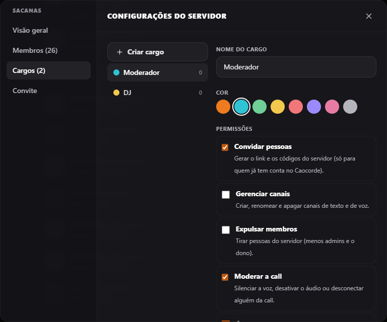
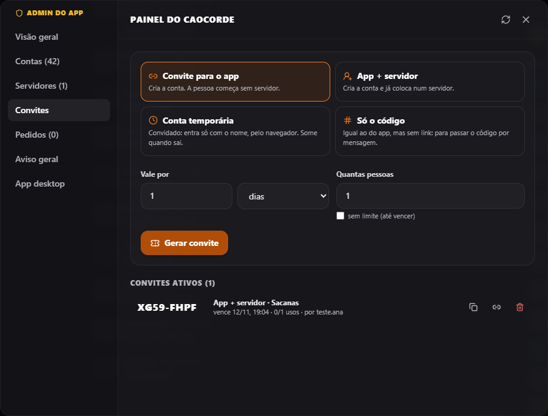
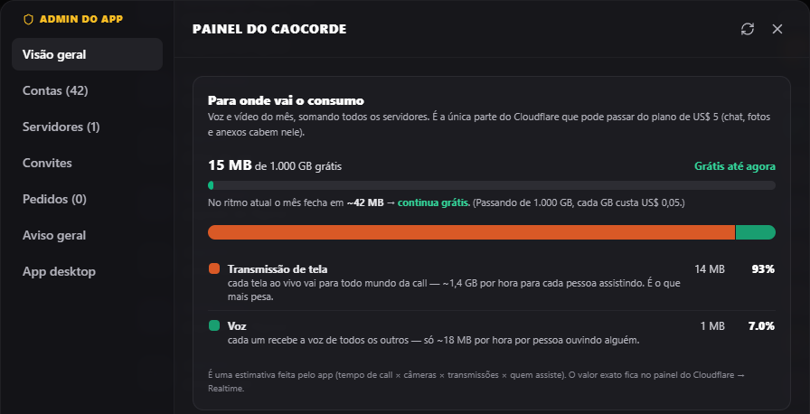
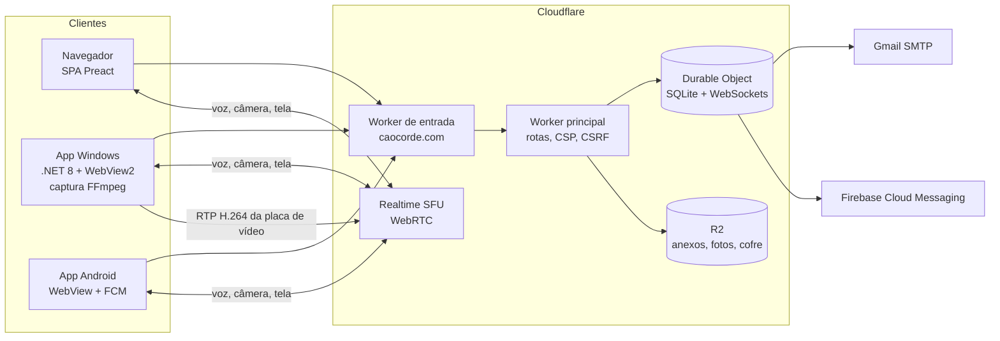

<p align="center"></p>

<h1 align="center">Caocorde</h1>
<p align="center"><b>Um "Discord" próprio para um grupo de amigos:</b> chat, call de voz e transmissão de jogo ao vivo, no navegador, no Windows e no Android.</p>
<p align="center"><a href="https://caocorde.com">caocorde.com</a> · estudo de caso · português (resumo em inglês no fim)</p>

> **Sobre este repositório.** Esta é a versão de **portfólio** do projeto: o código real do produto, sem segredos, sem
> identificadores da conta de hospedagem e sem um app anterior (o "Telinha") que ainda roda em paralelo. O produto
> em uso fica num repositório privado. **Todos os direitos reservados**: o código está aqui para leitura e avaliação,
> não para reutilização.

---

## O problema

Um grupo de amigos queria um lugar só deles para conversar e jogar junto, com três exigências:

1. **Transmitir jogo com qualidade**, inclusive em tela cheia e com placas de vídeo de marcas diferentes (NVIDIA, AMD, Intel).
2. **Custo perto de zero** enquanto o grupo é pequeno, sem servidor ligado 24 horas em casa.
3. **Fechado e seguro**: só entra quem alguém conhece, e conteúdo/contas problemáticos podem ser removidos de verdade.

## A solução em uma frase

Uma aplicação web (Preact) servida e operada inteiramente na borda da Cloudflare (Workers + um Durable Object com
SQLite), com voz e vídeo por WebRTC no **Cloudflare Realtime (SFU)**, um app de **Windows** que captura a tela pela
placa de vídeo (FFmpeg + NVENC/AMF/QSV) e envia RTP direto ao SFU, e um app **Android** (WebView) com notificações.

## Telas

| Primeira visita | Página inicial (+18, por convite) |
|---|---|
|  |  |
| **Pedir acesso** (3 perguntas) | **Cadastro** com o código já conferido e travado |
|  |  |
| **Amigos** (pedidos, bloqueados) | **Cargos** com permissões |
|  |  |
| **Painel do admin:** convites | **Painel do admin:** custo do mês |
|  |  |

## O que o app faz

- **Servidores, canais e mensagens** como no Discord: texto com respostas, edição, menções, anexos (imagem, vídeo, áudio, mensagem de voz) e mensagens diretas.
- **Call de voz, câmera e transmissão de tela** com qualidade ajustável ao vivo e estatísticas para os admins.
- **Filtro de ruído em 3 níveis**: sem filtro, "Estúdio" (RNNoise) e **"Foco na voz"**, um portão que só abre para voz humana (volume na faixa da fala + probabilidade de voz do RNNoise + detecção de tom, decidido a cada 10 ms).
- **Bot de música** na call (YouTube, SoundCloud e playlists), rodando no app de Windows de quem é o "DJ".
- **Acesso só por convite**: página inicial com "pedir acesso"; o admin aprova e o servidor manda por e-mail o link de cadastro e os instaladores. Convites com prazo e número de usos, e **acesso temporário de convidado** (sem conta, some quando sai).
- **Amizades, bloqueio e silenciar pela conta**, e **cargos** com 7 permissões por servidor.
- **Painel do admin**: consumo do mês (o que pode passar do plano grátis), contas, servidores, convites, pedidos e aviso geral.
- **Apagar conta de verdade**, guardando antes um registro **cifrado** que nem o admin consegue abrir pelo app (ver Segurança).

## Arquitetura



**Decisões e por quê:**

- **Um único Durable Object com SQLite** guarda contas, servidores, mensagens, presença e o estado das calls. Para um grupo de dezenas de pessoas, um objeto só simplifica tudo (transações, consistência, broadcast) e cabe no plano barato. Os **WebSockets com hibernação** e a **resposta automática ao "ping"** fazem o objeto não acordar à toa (não gasta).
- **SFU em vez de servidor de mídia próprio**: o Realtime cobra só o tráfego que sai (1.000 GB grátis por mês). O painel do admin estima esse consumo por tipo (voz, câmera, tela, música) para ninguém ser surpreendido.
- **Transmissão nativa no Windows**: o navegador não captura bem jogo em tela cheia nem usa o encoder da placa. O app usa FFmpeg (gfxcapture/Desktop Duplication + NVENC/AMF/QSV/Media Foundation/x264), um **pacer RTP próprio** (`EnvioCompassado.cs`) para não estourar a fila, qualidade automática em degraus e reinício da captura quando o jogo troca de resolução.
- **Código organizado por assunto** no servidor (`acessoAoApp.js`, `amizades.js`, `cargos.js`, `convidados.js`, `conversasDiretas.js`, `cofre.js`, `musicaDaCall.js`, `painelDoAdmin.js`), juntados à classe do Durable Object por "mixins".
- **Nomes e comentários explícitos em português**, pensados para quem não programa conseguir acompanhar.

## Segurança

| Ameaça | Como foi tratada |
|---|---|
| Senha vazada do banco | PBKDF2-SHA256 encadeado (6 × 100 mil = 600 mil iterações, o mínimo do OWASP), migrado no login de contas antigas |
| Sessão roubada do banco | O banco guarda só o **hash** do token de sessão e do link de "senha nova" |
| XSS | CSP restritiva (script só do próprio site), nenhum HTML vindo do usuário, anexos servidos com `sandbox` e `nosniff` |
| Pedido forjado (CSRF) | Cookie `SameSite=Lax` + conferência do `Origin` em toda ação da API e no WebSocket |
| Adivinhar convite/senha | Travas por endereço e por conta (senha, convite, pedido de acesso, "esqueci a senha", downloads) e tempo de resposta igual para usuário que não existe |
| Acesso indevido | Cada mensagem do WebSocket confere permissão (membro, admin, cargo); convidado tem lista fechada de ações; presença e fotos só para quem divide servidor ou é amigo |
| Escalada por cargos | Quem gerencia cargos só dá permissões que ele mesmo tem; quem expulsa ou modera pelo cargo não atinge admins |
| SSRF no bot de música | O app só aceita links de sites conhecidos e passa os argumentos ao yt-dlp sem shell (`ArgumentList` + `--`) |
| Conta apagada | Antes de apagar, as mensagens vão para um **cofre**: AES-256-GCM com a chave trancada por RSA-OAEP-4096. O servidor só tem a chave **pública**; a privada fica fora da internet (`ferramentas/criar-chave-do-cofre.mjs`) |
| Menores de idade | O app é +18: confirmação no pedido de acesso e no cadastro |

## Testes

- **156 testes de ponta a ponta** (`src/Cloudflare/testes/ponta-a-ponta/`) que falam com o servidor local como a página falaria: acesso por convite, convidado, mensagens diretas, amizades e cargos, moderação de voz, permissões da música, playlists, sessão e senha, e as travas de segurança.
- **6 testes de unidade** do servidor, **15 do filtro de ruído** (com som de verdade: fala, chiado, teclado, palmas, furadeira, grito, num simulador de AudioWorklet em Node) e **35 do app de Windows** (xUnit).

## Estrutura

```
src/App/               página (Preact + Vite + Tailwind) — store.js (estado e WebSocket), voz.js (WebRTC/SFU)
src/App/branding/      logo e ícones (SVG → PNG/ICO)
src/Cloudflare/        Workers + Durable Object (src/*.js) e os testes de ponta a ponta
src/ConcordeDesktop/   app Windows (.NET 8 WinForms + WebView2); Captura/ = transmissão nativa e bot de música
src/ConcordeAndroid/   app Android (WebView, notificações, atualização)
installer/             instalador do Windows (Inno Setup) e partes da atualização automática
docs/design.md         sistema visual (cores com contraste conferido, componentes)
ferramentas/           diagnósticos de captura e as ferramentas do cofre
```

## Rodar localmente

```bash
cd src/App && npm install && npm run build
cd ../Cloudflare && npm install
# src/Cloudflare/.dev.vars: CF_APP_TOKEN (Realtime) e, se quiser testar o cofre, COFRE_CHAVE_PUBLICA
npx wrangler dev --port 8790 --persist-to .wrangler/state-teste
# em outro terminal, com o servidor de pé:
npm run test:ponta-a-ponta
```

O endereço `http://concorde.localhost:8790` se comporta como o endereço principal. Em `wrangler.jsonc`, troque
`SEU_CF_APP_ID` e `seu-email@gmail.com` pelos seus. Algumas rotas antigas (`/s/<sala>`, `/api/salas`, WHIP/WHEP)
existem por compatibilidade com o app anterior, que não está neste repositório.

## Tecnologias

Preact, Vite, Tailwind · Cloudflare Workers, Durable Objects (SQLite), R2, Realtime (SFU) · WebRTC, AudioWorklet,
RNNoise (WebAssembly) · .NET 8, WinForms, WebView2, SIPSorcery, FFmpeg, NetMQ · Android (Java, WebView), Firebase
Cloud Messaging · Inno Setup · Node test runner, xUnit.

---

### English summary

**Caocorde** is a private Discord-style app built for a group of friends: text channels, DMs, voice/video calls and
low-latency game streaming, on the web, Windows and Android. Everything runs on Cloudflare's edge: a Worker plus a
single SQLite-backed Durable Object with hibernating WebSockets, R2 for files, and Cloudflare Realtime (SFU) for
WebRTC. The Windows app captures the screen through the GPU encoder (FFmpeg with NVENC/AMF/QSV) and sends paced RTP
straight to the SFU. Highlights: invite-only onboarding with admin approval by e-mail, roles with bit-flag
permissions and anti-escalation, friends/blocking, a voice-gated noise filter built on RNNoise, an encrypted
"vault" (RSA-OAEP-4096 + AES-256-GCM, public key only on the server) for deleted accounts, and 156 end-to-end tests.
All rights reserved — published for review, not for reuse.
